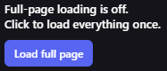
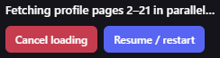

# Emoji.gg Universal Full Page Loader

Load complete Emoji.gg profiles, emoji searches, and sticker searches without repeatedly waiting for or pressing **Load more**.

I created this userscript because I wanted to browse a profile's full selection of emojis without the delay and practical limitations of Emoji.gg's incremental loading. I also wanted searching for emojis and stickers to be less tedious: one request should be enough to expand the current listing instead of repeatedly scrolling, waiting, and pressing **Load more**.

The script keeps normal browsing lightweight. Profiles, the homepage, and emoji or sticker listings only perform a full load when you explicitly request it.

## What it looks like

### Emoji and sticker listings

### User profiles

## Features

- Adds an opt-in **Load full profile** control to any public Emoji.gg profile at `/user/<username>`.
- Uses a compact, monochrome, semi-transparent black control panel that stays readable without overpowering the page.
- Reads the active profile's Emoji count for progress context without trusting that potentially stale badge as a loading limit.
- Loads profiles in continuous 500-item batches by fetching 20 profile pages in parallel.
- Continues past the reported profile count and stops only after three checks of the next real page return no items.
- Removes duplicate cards introduced when the site's native loader overlaps with the faster loader.
- Adds an opt-in **Load full page** control to:
  - the Emoji.gg homepage;
  - `/emojis` and `/emojis/<tag>` pages;
  - `/stickers` and `/stickers/<tag>` pages.
  - `/category` and `/category/<name>` pages.
- Repeatedly finds and activates Emoji.gg's own **Load more** control until the listing stops growing.
- Lets you pause a running load and start it again later.
- Returns to the top after a confirmed complete load.
- Shows collection tools only while a saved collection has items, on every Emoji.gg page.
- Shows a live item count, compact image previews, and an expandable preview of the full collection.
- Hover over a preview to reveal its **×** button and remove just that item. The button also appears on keyboard focus and stays visible on touchscreens. Removal synchronizes across tabs and updates selected checkmarks immediately.
- Opens **Submit collection** in a new tab, preserving the loaded profile. Submission is disabled above the site's 32-item limit.
- Clears successfully submitted items across open tabs only after Emoji.gg confirms success; failures preserve the collection and items added during submission remain available.
- Provides **Clear collection** to reset saved items, each open tab's in-memory collection, and selected checkmarks without reloading or losing a fully loaded page.
- Does not continuously refresh pages or automatically expand normal search and discovery pages.
- Runs entirely in your browser and does not send browsing data to another service.

## How it works

### Profiles

Opening a supported profile leaves Emoji.gg's normal initial page unchanged until **Load full profile** is selected. The loader then fetches 20 consecutive profile pages in parallel, merges as many as 500 items into the visible profile, filters duplicate item IDs, and immediately continues with the next batch. The profile badge is displayed only as context because Emoji.gg may not update it immediately after new uploads. The loader therefore continues beyond that number and confirms the actual end by checking the next page three times. If items appear during an end check, batching resumes automatically.

The profile panel provides:

- **Load full profile** — starts loading or continues after a pause or recoverable error.
- **Cancel loading** — pauses the current operation and preserves what has already loaded.
- **Collection · count/32** — appears when items are selected; click to expand or collapse the preview.
- **Submit collection ↗** — opens the pack form in a new tab. Complete the title, tags, and description and submit there. Confirmed success clears the submitted selection across tabs automatically.
- **Clear collection** — empties the saved collection and resets selected icons across all open Emoji.gg tabs while keeping the loaded profile in place.

### Homepage, emoji listings, and sticker listings

These pages are not expanded automatically. The panel displays **Load full page** so ordinary browsing remains quick and memory-conscious.

When selected, the script performs a one-time refresh, scrolls to the listing controls, repeatedly activates the site's **Load more** button, waits for new cards, removes duplicates, and continues until three consecutive checks find no additional results. The active operation can be paused; pressing **Load full page** again starts another continuation pass.

## Installation

### Install directly from GitHub (recommended)

1. Install [Tampermonkey](https://www.tampermonkey.net/) or another compatible userscript manager.
2. Open the [raw userscript](https://raw.githubusercontent.com/itschase/emoji-gg-universal-full-page-loader/main/emoji-gg-universal-full-page-loader.user.js).
3. Accept the userscript manager's installation prompt.
4. Visit [Emoji.gg](https://emoji.gg/).

The userscript's `@updateURL` and `@downloadURL` both point directly to that GitHub-hosted `.js` file, so installations made from the raw GitHub link check GitHub for future updates.

If you previously installed the script from Greasy Fork, install it once from the raw GitHub link above so the userscript manager records GitHub as the update source. The script name and namespace remain the same, allowing the direct installation to replace the existing copy in compatible userscript managers.

### Greasy Fork listing

The script also has a [Greasy Fork page](https://greasyfork.org/en/scripts/604578-emoji-gg-universal-full-page-loader), but the direct GitHub installation is recommended when you want updates from this repository.

## Supported routes

| Page | Behavior |
| --- | --- |
| `/user/<username>` | Displays an opt-in full-profile loader and verifies the real end when selected. |
| `/` | Displays an opt-in one-time full-page loader. |
| `/emojis` | Displays an opt-in one-time full-page loader. |
| `/emojis/<tag>` | Displays an opt-in one-time full-page loader for that listing. |
| `/stickers` | Displays an opt-in one-time full-page loader. |
| `/stickers/<tag>` | Displays an opt-in one-time full-page loader for that listing. |
| `/category` | Displays an opt-in one-time full-page loader. |
| `/category/<name>` | Displays an opt-in one-time full-page loader for that category. |

Collection controls are available on every Emoji.gg route when items are selected, including submission and account pages where the loading controls do not apply. Changes synchronize through browser storage and a live cross-tab channel. The script refreshes the site's in-memory collection before add/remove actions, so an older fully loaded tab cannot restore the previous pack's items. Switching tabs also refreshes the current selection.

On submission, account, marketplace, and other unrelated Emoji.gg pages, the widget stays hidden until a collection exists and then displays only collection controls. It does not run loading behavior there.

Automatic clearing uses Emoji.gg's confirmed successful `/api/submit/pack` response, not a button click, timeout, redirect, or guessed success message. Only IDs sent in that request are removed; additional items selected while the request is pending stay in the collection. Already open tabs need this version running to participate fully in synchronization. After installing the update, reload each existing tab once; future collection cycles preserve the loaded page.

## Resource usage

Loading hundreds or thousands of cards at once can use considerably more memory than Emoji.gg's default incremental view. The listing loader therefore remains opt-in. Use **Cancel loading** or **Stop full load** if a page becomes too heavy for your browser.

## Compatibility

The script targets modern Chromium- and Firefox-based browsers with a current userscript manager. It relies on modern browser features including `fetch`, `AbortController`, `DOMParser`, optional chaining, and the CSS `:has()` selector.

## Troubleshooting

- If loading pauses after a network error, use **Load full profile** again.
- If Emoji.gg temporarily stops responding, use **Load full profile** to continue from the page after the last completed batch.
- If a listing has changed since the last pass, press **Load full page** again.
- If Emoji.gg changes its card or pagination markup, please open an issue with the affected URL and browser version.

## Privacy and permissions

The userscript runs only on `https://emoji.gg/*`. It uses the active Emoji.gg session solely to request pages from Emoji.gg itself. It does not collect analytics, transmit profile data elsewhere, or use third-party APIs.

## Contributing

Bug reports and focused improvements are welcome through [GitHub Issues](https://github.com/itschase/emoji-gg-universal-full-page-loader/issues). Please describe the affected route, expected result, actual result, and browser/userscript-manager versions.

## License

Released under the [MIT License](LICENSE).
