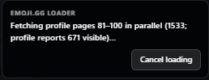
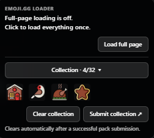

# Emoji.gg Full Page Loader & Collection Manager

**Load more of Emoji.gg with less waiting—and turn your loaded page into a convenient workspace for creating collections.**

This userscript adds fast, optional full-page loading to Emoji.gg profiles, emoji and sticker listings, searches, and categories. A compact collection manager lets you preview selections, remove individual items, open pack submission in another tab, and start the next collection without refreshing your browsing page.

**Release: 1.0 · License: MIT · Author: Chase (itschase)**

[Install from GitHub](https://raw.githubusercontent.com/itschase/emoji-gg-full-page-loader-collection-manager/main/emoji-gg-universal-full-page-loader.user.js) · [Source](https://github.com/itschase/emoji-gg-full-page-loader-collection-manager) · [Report an issue](https://github.com/itschase/emoji-gg-full-page-loader-collection-manager/issues)

## Why I created it

I wanted to browse someone's entire emoji profile without repeatedly waiting for Emoji.gg's incremental loading or scrolling through another small section at a time. The same problem made searching for emojis and stickers tedious: finding the right image should not require repeatedly stopping to press **Load more**.

Full-page loading is the main purpose of this script. You choose when to expand a profile or listing, and the loader keeps requesting more available results until it confirms the end. Ordinary browsing stays lightweight until you ask for a full load.

Collection management grew out of the next practical problem: after spending time loading a profile and choosing a pack, submitting it in another tab could leave the original page holding an old selection. Adding a new item could bring the previous collection back. This script synchronizes the saved collection and the site's in-memory state across tabs, so the loaded page remains useful for your next pack.

## Screenshots

### Continuous profile loading

The loader shows which pages are being requested, how many items are visible, and the profile's reported count. **Cancel loading** preserves results already loaded.

### Compact loader and collection manager

Loading and collection controls share a small, translucent black panel. Collection controls appear only when you have selected items. Click the collection heading to expand previews; hover over a preview to reveal its remove button.

## Fast full-page loading

- **Opt-in profiles:** click **Load full profile** on a public `/user/<username>` page when you want everything available.
- **Large parallel batches:** requests 20 profile pages together, normally up to 500 items per batch, then immediately continues with subsequent batches.
- **Counts are context:** the profile badge may lag behind newly published uploads. Loading continues beyond that count when additional items are returned.
- **End verification:** after reaching the apparent end, three empty checks of the next real profile page confirm completion. New results resume loading.
- **Listings and searches:** the homepage, emoji and sticker listings, tag searches, and categories use the site's loading controls to retrieve more results automatically during a requested full load.
- **Duplicate protection:** repeated cards are filtered when the native site loader overlaps with the userscript.
- **Cancel and continue:** pause profile loading while retaining loaded items, then use the load control to continue.
- **Back to the top:** confirmed completion returns you to the beginning of the loaded page.
- **You decide when:** profiles and listings do not expand automatically on a normal visit.

### Loading a profile

1. Open a public Emoji.gg profile.
2. Select **Load full profile**.
3. Follow progress while pages are fetched and merged into the existing grid.
4. Use **Cancel loading** to pause. Loaded items remain visible.
5. Select **Load full profile** again to continue after a pause or connection error.

Results arrive in page order, with duplicate item IDs omitted. The profile's stated count is displayed only as context. The loader keeps checking returned pages to determine the actual end. Running it again after completion starts another pass so newly available items can be found.

### Loading the homepage, searches, stickers, and categories

Select **Load full page**. The current listing receives a one-time refresh, then the script scrolls to the bottom, finds and activates **Load more**, waits for new cards, removes duplicates, and repeats until three checks find no additional items.

Use **Stop full load** to pause; currently visible items remain. Selecting **Load full page** again starts a new one-time refresh and loading pass. Finish any unsaved page work before starting a listing load. The script does not continuously refresh pages or automatically expand future normal visits.

## Collection manager

- **Visible when needed:** the collection section stays hidden until items have been selected.
- **Live count:** see the current selection against the site's 32-item pack limit.
- **Compact previews:** shows the first five selected images and the number of additional items.
- **Expand or collapse:** click the collection heading to browse all selected images in a scrollable panel.
- **Remove one item:** hover over its preview and click **×**. Keyboard focus also reveals the button; touchscreens show it continuously.
- **Clear collection:** reset the temporary selection from any Emoji.gg tab while preserving the loaded page.
- **Submit in a new tab:** open the pack form without navigating away from your profile or listing. This action is disabled above 32 selected items.
- **Synchronize tabs:** saved selections, counts, previews, and selected card indicators stay synchronized between participating Emoji.gg tabs in the same browser profile.
- **Clear after success:** only confirmed successful pack submissions remove submitted items. Failed submissions retain their selection.
- **Keep new work:** unrelated items added while a submission is pending remain available for the next pack.

### Create multiple packs from one loaded page

1. Load the profile or listing you want to browse.
2. Add emojis using Emoji.gg's normal collection buttons.
3. Review the count and previews. Expand the heading to inspect the full selection.
4. Hover over a preview and click **×** to remove unwanted items. Other tabs and selected indicators update too.
5. Select **Submit collection ↗** to open the pack form in a new tab.
6. Fill in the title, tags, and description, review the pack, and submit it yourself.
7. Wait for Emoji.gg's successful-submission confirmation. Submitted items clear from shared storage and cached selections across participating tabs.
8. Return to the original loaded page and select the next pack. No profile reload is needed for this collection cycle.

**Clear collection** also allows a manual reset. Removing a temporary selection does not delete an uploaded emoji or an already submitted pack. The script manages the workflow; it does not write pack metadata, submit packs automatically, or bypass submission limits and moderation.

### How collection synchronization works

Emoji.gg stores the collection in browser storage and caches another copy in each open tab. Changing storage alone is not enough: an older page can otherwise restore its stale copy when another item is selected.

The script refreshes that cached state before the site's add, remove, and submit handlers run. Browser storage events and a live cross-tab channel synchronize changes. Focus checks and a lightweight periodic fallback cover delayed initialization. Synchronization does not replace or navigate away from the loaded profile grid.

Automatic clearing listens for a confirmed successful `/api/submit/pack` response and uses the IDs actually sent in that request. A button click, timeout, or redirect alone never counts as success. If the request fails, the collection remains. If additional unrelated items were selected while it was pending, those remain for the next pack.

## Installation

1. Install [Tampermonkey](https://www.tampermonkey.net/) or a compatible userscript manager.
2. Open the [direct GitHub userscript](https://raw.githubusercontent.com/itschase/emoji-gg-full-page-loader-collection-manager/main/emoji-gg-universal-full-page-loader.user.js).
3. Review the script and accept the manager's installation prompt.
4. Visit [Emoji.gg](https://emoji.gg/). Loading controls appear on supported pages; collection controls appear after selecting items.

The script runs on `https://emoji.gg/*` with `@grant none`. The repository keeps the existing userscript filename; its title, homepage, support link, and update URLs use the renamed project.

### Updates directly from GitHub

Both `@updateURL` and `@downloadURL` point directly to the script in **itschase/emoji-gg-full-page-loader-collection-manager**. GitHub is the intended source for the most recent releases. Your manager controls update-check timing and any source overrides.

If an installation from a script directory is not checking GitHub, open the direct installation link once and review its update settings. After updating, reload existing Emoji.gg tabs once so each tab runs the same version.

### Migration from Universal Full Page Loader

This is **1.0 of the renamed project**, combining the full-page loader and collection manager developed under **Emoji.gg Universal Full Page Loader**.

The old project reached versions above 1.0. A userscript manager may refuse to treat this release as an upgrade or may install it alongside the differently named script. Install this renamed script explicitly and disable or remove the old installation so only one copy runs. Confirm the new update URLs use `emoji-gg-full-page-loader-collection-manager`.

Your saved Emoji.gg collection is not intentionally cleared merely by installing the script. Reload existing Emoji.gg tabs once after replacing the old installation. Future collection cycles can keep the profile loaded.

## Supported pages

| Page | Loading | Collection controls |
| --- | --- | --- |
| `/user/<username>` | Load full profile | Visible when selected items exist |
| `/` | Load full page | Visible when selected items exist |
| `/emojis` and `/emojis/<tag>` | Load full page | Visible when selected items exist |
| `/stickers` and `/stickers/<tag>` | Load full page | Visible when selected items exist |
| `/category` and subpages | Load full page | Visible when selected items exist |
| `/submit/pack` | No loading control | Previews, removal, clear, and submission-result synchronization |
| Other `https://emoji.gg/*` pages | No loading control | Visible when selected items exist |

## Troubleshooting

- **No widget:** loading controls appear only on supported profiles and listings. Other pages show collection tools only when items are selected. Check that the script is enabled.
- **A profile pauses after a connection error:** select **Load full profile** again to retry from the next unfinished batch.
- **Reported and loaded counts differ:** profile badges can be stale. Actual returned pages determine the end.
- **A listing seems incomplete:** run **Load full page** again. Temporary server responses affect available results.
- **Another tab still shows old selections:** ensure it runs this script and focus it. Tabs opened before an update need one reload to use the new code.
- **Two widgets appear:** disable the old script or another duplicate installation and reload once.
- **Submit collection is disabled:** reduce the selection to 32 items or fewer.
- **Submission failed:** review Emoji.gg's message and correct the pack. Selections remain available for another attempt.
- **The manager keeps an older version:** check update settings or explicitly install the new GitHub script. The version reset can require manual migration.

## Performance and compatibility

Loading hundreds or thousands of image cards uses more memory than Emoji.gg's initial view. Full loading stays optional; cancel if the page becomes too heavy. Parallel requests reduce waiting, but actual speed depends on the server, connection, and browser.

The script targets modern Chromium and Firefox browsers with a compatible userscript manager. It uses `fetch`, `AbortController`, `DOMParser`, browser storage, optional chaining, and CSS `:has()`. `BroadcastChannel` is used where available, with storage events and focus synchronization as additional paths. Site markup and request behavior can change; loading and success detection depend on those interfaces remaining compatible.

## Privacy

The script adds no analytics and does not send inventories, selections, or browsing history to an external service. Loading requests go to Emoji.gg with your existing session. Previews use Emoji.gg's image CDN. Collection data stays in the site's browser storage and synchronizes between participating tabs. Your userscript manager separately checks its configured source for updates.

## Feedback and contributions

Open a [GitHub issue](https://github.com/itschase/emoji-gg-full-page-loader-collection-manager/issues) with the affected page, expected and actual behavior, browser, userscript manager, and script version. Never include passwords or session cookies. Focused improvements to loading reliability, collection workflows, accessibility, and the compact widget are welcome.

## License

Released under the [MIT License](https://github.com/itschase/emoji-gg-full-page-loader-collection-manager/blob/main/LICENSE).
